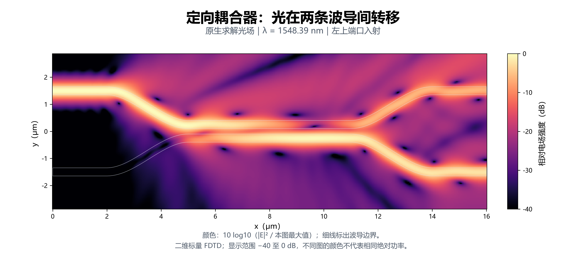
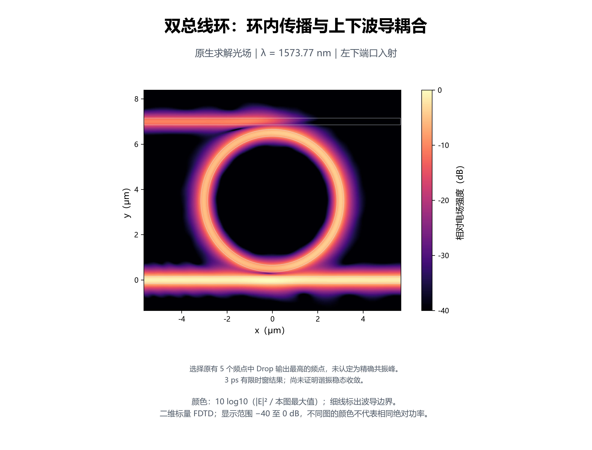

# 光子集成电路仿真 · Photonic Integrated Circuit Simulation

**面向集成光子学的建模、仿真、验证与工具复用 skill。COMSOL 与 Lumerical 是其中并列的求解器子项目。**

[English](README.md) · [版本与兼容性](#版本与兼容性) · [项目结构](#项目结构) · [快速开始](#快速开始) · [COMSOL](#原生-comsol-工作流) · [Lumerical](#原生-lumerical-工作流) · [实际图样](#实际仿真图样) · [文档导航](#文档导航)

[](CHANGELOG.md)
[](pyproject.toml)
[](https://github.com/Bian-M-X/photonic-integrated-circuit-simulation-skill/actions/workflows/python-compat.yml)
[](https://github.com/Bian-M-X/photonic-integrated-circuit-simulation-skill/actions/workflows/platform-compat.yml)
[](https://github.com/Bian-M-X/photonic-integrated-circuit-simulation-skill/actions/workflows/agent-compat.yml)
[](LICENSE)

`photonic-integrated-circuit-simulation` 是总项目和 agent skill，涵盖器件与电路建模、
知识库、工程工作流及仿真证据管理。`photonic-workflow` 是配套 Python 运行时，
通过共享 CLI、MCP、几何与材料配方、电路工具和优化合同支撑这些工作。
**COMSOL 与 Ansys Lumerical** 分别承担原生建模和求解，按各自实现与证据范围接入共同流程。

- **复用已有积累**：共享数值几何、材料公式、数据合同和电路工具。
- **明确后端实现**：分别构建各求解器的原生对象、模态、边界和网格。
- **检查实际证据**：保留每个声明输入的源列、原始数组、模型文件及文件哈希。

当前包版本：**0.9.0 · alpha**。本版包含下述 COMSOL/Lumerical 共享工作流，详见 [CHANGELOG](CHANGELOG.md)。
核心功能无需商业求解器；原生运行需要另外安装相应产品并具备可用许可。

## 版本与兼容性

| 项目 | 当前 checkout | 依据 |
|---|---|---|
| 运行时包 | **`photonic-workflow` 0.9.0 · alpha** | [版本源](src/photonic_workflow/_version.py) · [包元数据](pyproject.toml) |
| 当前版本内容 | **0.9.0** 包含 COMSOL/Lumerical 并列工作流与共享工具 | [CHANGELOG](CHANGELOG.md) · [GitHub 发布页面](https://github.com/Bian-M-X/photonic-integrated-circuit-simulation-skill/releases) |
| Python | **3.11+**；Windows CI：3.11–3.14；Ubuntu/macOS portable-core CI：3.11、3.14 | [Python 检查](.github/workflows/python-compat.yml) · [平台检查](.github/workflows/platform-compat.yml) |
| MCP | 协议 **`2025-06-18`**；**18 个工具 / 43 个资源** | [MCP 服务](src/photonic_workflow/mcp/server.py) · [接入说明](references/comsol-mcp-evaluation.md) |
| 数据接口 | API envelope **1.0**、默认合同 schema **1.0**、适配器 SPI **1.0** | [兼容性常量](src/photonic_workflow/compatibility.py)；具体合同按自身声明的 schema 解释 |
| 建模配方 | 请求 schema **1.0**；当前六个配方均为 **1.0.0**，与包版本独立维护 | [配方合同](references/modeling-recipes.md) · `photonic recipe list --json` |

自 0.7.0 起，skill 名为 `photonic-integrated-circuit-simulation`；Python 分发包、导入路径与
`photonic` CLI 名称保持兼容。已有 `assembly.json` 1.0、复数 S CSV 和旧脚本入口见
[迁移与兼容说明](docs/migration.md)。[下方版本记录](#版本记录)列出当前版本与早期源码里程碑。

## 项目结构

| 层次 | 内容 | 入口 |
|---|---|---|
| Skill 总项目 | 器件、电路、量子光子学知识库，工程判断、验证与报告工作流 | [SKILL.md](SKILL.md) · [工程工作流](references/engineering-workflow.md) |
| 共享工具层 | Python API、`photonic` CLI、MCP、建模配方、复数 S 电路、优化与来源记录 | [建模配方](references/modeling-recipes.md) · [层次组合](references/hierarchical-device-workflow.md) |
| COMSOL 子项目 | Java 原生建模与执行、模态端口、完整源扫描、器件校准、PN 基准与伴随示例 | [原生器件库](references/native-device-library.md) · [环境与运行器](references/environment-and-runner.md) |
| Lumerical 子项目 | 原生 API、MODE/FDTD、共享几何与材料、完整源扫描、结果交换与候选评估 | [安装与诊断](references/lumerical-workflows.md) · [完整器件](references/lumerical-device-workflow.md) |

两条求解器路线复用工程经验与数据工具；原生物理接口、边界、网格、优化方法和验收证据分别说明。

## 快速开始

需要 **Python 3.11+**。从源码 checkout 安装：

```powershell
git clone https://github.com/Bian-M-X/photonic-integrated-circuit-simulation-skill.git
Set-Location photonic-integrated-circuit-simulation-skill
python -m pip install -e .
photonic --version
```

创建 MZI 示例并组合电路，整个过程不启动求解器：

```powershell
photonic init demo-mzi --device-family mzi --json
photonic check --project-root demo-mzi --json
photonic circuit validate demo-mzi/circuits/assembly.json --json
photonic circuit compose demo-mzi/circuits/assembly.json `
  --output demo-mzi/data/processed/circuit_sparameters.csv `
  --summary demo-mzi/verification/circuit_summary.json --json
photonic status --project-root demo-mzi --json
```

输出包括电路复数 S 矩阵和组合摘要。内置确定性解析数据用于验证运行时，
不代表全波仿真或实物器件验收。重复执行时应使用新的项目、输出目录。

如需使用 agent skill，将 checkout 安装到智能体可发现的 skills 目录，
加载作为[操作路由](SKILL.md)的 `SKILL.md`。skill 名为 `photonic-integrated-circuit-simulation`，
Python 包与命令行名称保持为 `photonic-workflow` 和 `photonic`。

## 原生 COMSOL 工作流

COMSOL 子项目提供从参数化模型、局部诊断到原生器件求解和逆向设计的工具与参考：

| 能力 | 当前实现与入口 | 适用范围 |
|---|---|---|
| 原生无源器件 | 直波导、交叉、定向耦合器、2×2 MMI、Y 分支、单/双总线环及环调制器几何；[JSON 请求](examples/native-devices/)与固定 Java 源生成 | 默认光学模型为二维标量折射率替代模型 |
| 模态与完整复数 S | 几何/材料读回、边界模态、同模型逐输入激励、端口/开放边界/吸收通量校准；[源扫描](references/frequency-domain-source-sweeps.md) | 保留端口顺序、相位约定、参考面与逐源功率；收敛需单独检查 |
| PN 与电光近似 | 一维突变耗尽 Poisson 原生基准、解析对照及载流子折射率投影；[PN 环模型](references/pn-ring-model.md) | 不等于漂移扩散、接触/RF 或真实 SOI 肋波导电光验证 |
| 伴随逆向设计 | 原生密度法、滤波/投影、MMA 与冻结掩膜验证；[Hadamard 可执行示例](examples/comsol-hadamard-inverse/README.md) | 需相应科学计算依赖及 Wave Optics/Optimization 许可；按具体二维案例验收 |
| 建模与调试知识 | 材料、实体选择、端口、网格、求解和场图审计；[波动光学](references/wave-optics-port-models.md)与[物理场审计](references/comsol-field-physical-audit.md) | 多物理场和三维扩展按具体模型构建、验证 |

先离线生成并核验直波导控制包，再显式调用本地 COMSOL：

```powershell
python -m pip install -e ".[comsol]"
photonic native list --json
photonic native prepare examples/native-devices/straight.json `
  --output runs/comsol-straight-001 --json
photonic native verify runs/comsol-straight-001 --json
photonic native run runs/comsol-straight-001 `
  --solver-root D:/Path/To/COMSOL/Multiphysics --cores 2 --timeout 600 --json
```

`prepare` 与 `verify` 不启动求解器。将安装路径替换为本机目录；`run` 核验固定源代码后，
使用匹配的 COMSOL 编译器与本地许可执行，并返回实际 `receipt` 路径。
用该路径替换下面的 `COMSOL_RECEIPT.json`，校准并导出完整复数 S：

```powershell
photonic native calibrate COMSOL_RECEIPT.json `
  --output runs/comsol-straight-result-001.json `
  --csv-output runs/comsol-straight-s-001.csv --json
```

原生请求可选择 `configure`、`modes`、`solve` 阶段；示例的 `solve` 在同一模型内逐端口求解。
校准会保留完整矩阵与逐输入有符号功率记录，不把进程成功或一次网格结果当作器件验收。
网格比较使用 `photonic native compare`，完整流程和 PN 命令见[原生器件库](references/native-device-library.md)。

## 原生 Lumerical 工作流

安装运行时附加依赖；该命令不会下载 Ansys 产品或许可：

```powershell
python -m pip install -e ".[lumerical]"
photonic lumerical discover --install-root D:/Path/To/Lumerical --json
photonic lumerical plan examples/lumerical/device-coupler.json `
  --install-root D:/Path/To/Lumerical --json
```

运行声明的四端口光学器件，检查实际源扫描，并导出数据：

```powershell
photonic lumerical run examples/lumerical/device-coupler.json `
  --output runs/coupler-001 --install-root D:/Path/To/Lumerical `
  --local-license --threads 2 --timeout 300 --json
photonic lumerical inspect-result runs/coupler-001/receipt.json --json
photonic lumerical device-export runs/coupler-001/receipt.json `
  --output coupler.csv --project-root runs/circuit-data-001 --json
```

请将安装路径占位符换成实际位置。`--local-license` 在需要时临时使用本机已有的
许可管理器；已配置并运行的服务可不带此选项使用。本地许可不需要外部互联网。
运行器保持许可文件、服务和代理配置不变；许可求解默认串行。

每个声明输入端口都实际激励一次，保存原生 `.fsp`、逐源数组、完整的所选模式 S 矩阵、
模场检查和哈希回执。CSV 导出保留复数值及原始 JSON 字节，
同时携带通道约定和参考面。详见[完整器件工作流](references/lumerical-device-workflow.md)。

示例为 **二维标量折射率替代模型**，不代表已校准的三维 SOI 堆栈。
另有显式三维接口，已实际验证三维直波导控制。几何参数使用 μm，
光学请求中以 `_m` 结尾的长度使用米。

如果已安装的控制台命令版本较旧，可在 checkout 中使用
`./scripts/invoke-lumerical.ps1` 代替 `photonic lumerical`。
通过 `photonic lumerical --help` 查看全部 11 个命令，包括数据导入与同器件网格比较。

## 实际仿真图样

### COMSOL：逆向设计与 Euler 分束器

| Hadamard 等效器件 · 1550 nm | SOI Euler 耦合器 · 1550 nm |
|---|---|
| [](docs/showcases/hadamard-2d/figures/field-linear.png) | [](docs/images/showcase/soi-euler-50-50/field-linear.png) |

Hadamard 案例保留二维体材料折射率替代模型、五波长伴随优化、固定掩膜、
八源模态读出与独立验证记录。记录中的 19 项固定掩膜检查和 13 组收敛比较通过；
公开复核器验证数值自洽，**不重新核验私有原生回执或重跑 COMSOL**。
场图按显示窗口峰值归一化，模型不代表三维 SOI 或实验量子过程层析。
详见[设计、光谱与复现说明](docs/showcases/hadamard-2d/README.md)。

Euler 图来自 **单输入、单波长的二维有效折射率模型**，记录的收集输出比例为
48.5839% / 51.4161%。四输入完整复数 S、带宽及边界敏感性尚未完成验收，
不据此宣称三维或工艺鲁棒性。详见[场图、配置与证据范围](docs/legacy-readme-zh.md#euler-splitter)。
另见[原生无源器件与 PN 基准记录](docs/research/native-library-v08.md)。

### Lumerical：定向耦合器与双总线环

以下图像来自本机 Lumerical 原生 DFT 场监视器，光场由实际求解导出。

| 定向耦合器 · 1548.39 nm | 双总线环 · 1573.77 nm |
|---|---|
| [](docs/images/lumerical/coupler_field.png) | [](docs/images/lumerical/ring_field.png) |

两者均为 **二维标量诊断模型**。颜色按各图自己的最大 `|E|²` 归一化，
不同图的相同颜色不代表相同绝对功率。环形器件在 **3 ps 有限时窗**处停止，
该图尚不能证明共振、Q 值或稳态已收敛。监视器添加在模型副本中，
对应输入的原生 S 源列与原记录完全一致。
详见[器件验证报告](docs/research/lumerical-device-workflow-2026-10-29.md)。

## 哪些共享，哪些由求解器实现？

| 层次 | 当前可用能力 | 证据或适用边界 |
|---|---|---|
| 无求解器核心 | 项目合同、解析器件模型、复数 S 电路、审计与来源记录 | 无需商业运行环境 |
| 几何与材料 | 七类光学器件、六个数值 recipe、Li 硅与 Malitson 石英公式 | 原生几何构建和材料拟合分别检查 |
| COMSOL | 原生器件运行/校准、PN-Poisson 控制和已有伴随示例 | 保留各模型、产品自己的证据 |
| Lumerical | MODE/FDTD 诊断、逐源器件矩阵、导出、功率比较与有界候选评估 | 七类光学外形；每个物理端口选择一个模式 |
| Recipe 后端 | 六个配方都输出通用 JSON；COMSOL Java；圆弧/Euler 的 Lumerical LSF | 几何渲染不求解光场 |
| MCP | **18 个工具 / 43 个资源**：发现、计划、配方、结果检查、导出、电路与证据 | 不通过 MCP 执行求解器或任意 shell |
| 跨求解器控制 | 匹配的二维标量直波导/耦合器计划，回执绑定的功率比较 | 不隐式对齐相位，不宣称普遍精度或速度优势 |

原有 COMSOL PN、伴随路径和多物理场建模指导继续保留，尚未转为
Lumerical 原生 CHARGE/HEAT/EME/INTERCONNECT 或伴随执行链。
FDTD 中的 `ring-modulator` 当前构建**光学外形**，不包含电压驱动的 PN 响应。
对应关系见[能力迁移审计](docs/research/lumerical-capability-matrix-2026-10.md)和[双求解器工作流](references/dual-solver-workflows.md)。

## 复用建模配方

先发现版本化配方，查看同一份数值几何的通用结果：

```powershell
photonic recipe list --json
photonic recipe inspect geometry.symmetric-euler-bend --json
photonic recipe render geometry.symmetric-euler-bend `
  --input examples/recipes/symmetric-euler-bend.json `
  --renderer canonical-json --json
```

按目标后端渲染同一配方：

| 输出 | 渲染器 | 使用范围 |
|---|---|---|
| 通用数值结果 | `canonical-json` | 六个内置配方，适合检查和跨工具复用 |
| COMSOL Java 片段 | `comsol-java-fragment` | 明确支持的几何/端口配方，需要安全实例名 |
| Lumerical LSF 片段 | `lumerical-lsf-fragment` | 圆弧路线与 Euler 几何，需要显式高度、折射率和实例名 |

```powershell
photonic init demo-recipes --device-family mzi --json
photonic recipe render geometry.symmetric-euler-bend `
  --input examples/recipes/symmetric-euler-bend.json `
  --renderer comsol-java-fragment --instance-id euler_main `
  --output generated/euler-main.java --project-root demo-recipes --json
photonic recipe render geometry.symmetric-euler-bend `
  --input examples/recipes/symmetric-euler-bend.json `
  --renderer lumerical-lsf-fragment --instance-id euler_main `
  --height-um 0.22 --core-index 3.476 `
  --output generated/euler-main.lsf --project-root demo-recipes --json
```

输出路径相对于 `demo-recipes`。LSF 的挤出高度与折射率由调用者显式给出。
圆弧使用原生解析环扇区，
Euler 弯保留通用结果中的全部边界采样点。原生片段提供建模构件，
完整堆栈、边界/PML、模式、求解和器件验收仍由目标模型负责。
材料、端口窗口等配方在原生脚本会改变其含义时保留数值输出。
详见[配方合同、Python API 与渲染器限制](references/modeling-recipes.md)。

## 用 MCP 消费同一份数据

通过明确的读、写根目录启动 stdio 服务：

```powershell
photonic-mcp --read-root D:/Path/To/Project `
  --write-root D:/Path/To/Project/runs
```

在 MCP 客户端的 stdio 配置中接入该命令。服务使用同一份包逻辑，
安装后的 wheel 也包含 COMSOL、Lumerical 和共同工作流的只读参考资源。
如需发现本地 Lumerical 安装，可额外添加 `--read-root D:/Path/To/Lumerical`。
更新后请重启正在运行的服务，使工具与资源目录刷新。

| 任务 | MCP 工具 |
|---|---|
| 复用配方 | `list_recipes`、`inspect_recipe`、`render_recipe` |
| 准备 COMSOL Java 批任务 | `run_java_batch`，只生成计划 |
| 准备 Lumerical 任务 | `discover_lumerical_install`、`plan_lumerical_run` |
| 检查、导出 Lumerical 结果 | `inspect_lumerical_result`、`compare_lumerical_results`、`export_lumerical_result` |
| 使用完整矩阵 | `validate_circuit`、`compose_circuit`、`validate_contract` |
| 检查项目证据 | `inspect_project`、`gate_status`、`audit_project_artifacts` |

实际许可求解仍通过显式 CLI 执行。兼容命名的 `run_java_batch` 只生成计划，
不运行 COMSOL。结果检查验证文件与记录一致性，不自动提升物理验收等级。
详见 [MCP 配置与接入边界](references/comsol-mcp-evaluation.md)。

## 对照、优化与验证

共享优化合同管理参数、目标、约束、评估预算和试验历史。
`photonic optimize suggest SPEC --trials TRIAL_DIRECTORY --json` 从已有冻结试验中只读提出候选，
不会启动求解器。不同后端、模型层级或目标定义的结果分别保存，不能直接混入同一历史。
详见[低成本优化](references/low-cost-optimization.md)和[优化与报告](references/optimization-and-reporting.md)。

COMSOL 的伴随/MMA 路线提供独立原生梯度和冻结掩膜验证流程。查看不执行求解的计划：

```powershell
python -m pip install -e ".[inverse-design]"
python examples/comsol-hadamard-inverse/campaign.py --output runs/comsol-hadamard-plan-001
```

实际原生运行需按[可执行示例](examples/comsol-hadamard-inverse/README.md)提供 COMSOL 路径并添加
`--execute`，保留其预算、重启检查和模型适用范围。Lumerical 的 `optimize-step` 则将共享预算
接到逐个 FDTD 候选评估；它不实现 COMSOL 伴随梯度。

在查看两端结果前固定共同基准：

```powershell
photonic lumerical plan-benchmark straight --power-tolerance 0.03 --json
photonic lumerical compare-solvers COMSOL_RECEIPT.json LUMERICAL_RECEIPT.json `
  --power-tolerance 0.03 --json
photonic lumerical optimize-step examples/lumerical/device-optimization.json `
  --output runs/coupler-opt-plan-001 --json
```

上面的回执路径为占位符。比较要求几何、材料、通道、模型层级和波长网格匹配。
容差应在求解前声明，未通过的比较保留原结果；功率一致不表示跨求解器相位一致。
Lumerical 优化默认写入计划，`--execute` 才实际评估一个有预算的候选。

Lumerical 子项目的本机记录包括 **16 次器件评估 / 51 个输入源列**、两次真实候选评估与历史续跑，
以及 **3 个原生 LSF CAD 案例 / 114 项属性检查**。
这些属于限定范围的诊断，不是对所有器件或后端的验收。
最新统一工具测试、两端比较和未解决偏差见
[本轮实现报告](docs/research/lumerical-unified-tools-2026-10-30.md)。

开发环境验证：

```powershell
python -m pip install -e ".[dev,comsol,lumerical]"
python -m pytest -q
python -m ruff check src tests scripts
python scripts/test_skill_metadata.py
./scripts/sync-packaged-skill-resources.ps1
```

CI 检查代码、合同、资源镜像、分发包和安装后的行为。
许可求解证据单独记录，详见[维护与兼容性说明](docs/maintenance.md)。

<details>
<summary>兼容性徽章检查什么</summary>

- **Python：**Windows 上 Python 3.11–3.14 的完整测试，以及静态质量和生成的 Java 片段检查。
- **平台：**Ubuntu/macOS 上 Python 3.11、3.14 的 portable-core 检查，以及 wheel/sdist 构建和 checkout 外安装验证。
- **智能体：**Codex、ChatGPT、Claude Code 所需的 skill 元数据、agent card 与发现目录布局。

这些 CI 检查验证软件兼容性；原生求解和器件证据另见对应实验报告。

</details>

<a id="updates"></a>

## 版本记录

| 版本 / 日期 | 主要变化 |
|---|---|
| **0.9.0 · 2026-10-30** | COMSOL/Lumerical 并列工作流；原生 MODE/FDTD 器件源扫描、LSF 配方、新增五个 MCP 工具、匹配功率对照与有预算的候选评估 |
| **0.8.0 · 2026-10-29** | COMSOL 原生无源/环/PN 几何、显式执行、完整复数 S/通量校准与规定耗尽电荷 Poisson 控制 |
| **0.7.0 · 2026-10-28** | PIC skill 名称、七种可执行器件基线、读回诊断、canary/弯曲工具与制造约束工作流指导 |
| **0.6.0 · 2026-10-10** | 有预算的候选建议、降低评估成本的逆向设计工具，以及原生 COMSOL Hadamard 伴随/MMA 示例 |
| **0.5.0 · 2026-09-09** | 按任务选择工程模式、聚焦验收范围，以及共享配方的发现、检查与渲染 |

以上是 [CHANGELOG.md](CHANGELOG.md) 记录的源码版本里程碑；已发布标签与可下载产物见
[GitHub Releases](https://github.com/Bian-M-X/photonic-integrated-circuit-simulation-skill/releases)，
发布流程见[维护说明](docs/maintenance.md)。

## 文档导航

| 需要做什么 | 从这里开始 |
|---|---|
| 智能体路由与工具选择 | [SKILL.md](SKILL.md) · [工具选择](references/tool-selection.md) |
| 共同工程流程 | [工程工作流](references/engineering-workflow.md) · [双求解器对应](references/dual-solver-workflows.md) |
| COMSOL 运行和器件 | [环境与运行器](references/environment-and-runner.md) · [原生器件库](references/native-device-library.md) · [端口与波动光学](references/wave-optics-port-models.md) |
| Lumerical 运行和器件 | [安装与诊断](references/lumerical-workflows.md) · [完整器件](references/lumerical-device-workflow.md) |
| 可复用数值工具 | [建模配方](references/modeling-recipes.md) · [可执行器件模型](references/executable-device-models.md) |
| 电路与量子光子学 | [层次组合](references/hierarchical-device-workflow.md) · [量子知识库](references/quantum-photonic-knowledge-base.md) |
| PN 与逆向设计 | [PN 环模型](references/pn-ring-model.md) · [COMSOL 伴随](references/comsol-adjoint-inverse-design.md) |
| 其他工具集成 | [MATLAB](docs/architecture/matlab-integration.md) · [PDK 模型](docs/architecture/pdk-model.md) · [适配器合同](docs/architecture/adapter-contract.md) |
| 复现、维护与历史 | [维护说明](docs/maintenance.md) · [CHANGELOG](CHANGELOG.md) · [历史 README](docs/legacy-readme-zh.md) |

提交 issue 或贡献时，请给出输入请求、模型层级、预期行为、实际结果和最小复现。
许可文件、凭据、私有 PDK 与专有求解模型应保留在公开贡献之外。

**MIT 许可。** 本独立项目不包含商业求解器或许可文件。
COMSOL、MathWorks 和 Ansys 名称只用于标识可选集成，不表示关联或背书。
详见[来源说明](references/source-notes.md)与[法律说明](references/legal-and-trademark-notes.md)。
