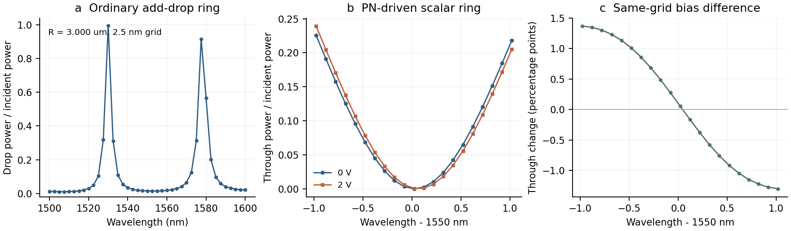

# Native library v0.8: measured diagnostic baselines

Snapshot: 2026-10-29. Completed COMSOL 6.4 native solves cover a **2D scalar-index optical surrogate** and a separate **1D prescribed-charge depletion–Poisson benchmark**. The four passive defaults below are tested starting geometries, not optimized low-loss or 50:50 components. Their measured powers make that distinction explicit. The [sanitized numeric overview](native-library-v08-results.json) binds each case to input, executed Java, console, calibration and receipt SHA-256 values; these demonstrate local evidence consistency, not authenticated experimental measurements.

For the four defaults, width is 0.30 µm, real core/cladding indices are 2.60/1.45, extinction is zero, port window is 2.40 µm, and maximum core/cladding/port mesh sizes are 0.015/0.16/0.01 µm. Cubic access polygons use 32 samples; coupler/MMI lead and transition lengths are 2/3 µm. The grid is 1540, 1550 and 1560 nm. Powers below are `|S[output, source]|²` for source port 1 at 1550 nm; flux diagnostics are maxima across the grid and all excitations, normalized to incident power.

| Default case | Geometry, µm | Reflection | Forward output powers | Max port-flux/modal gap | Max signed flux imbalance |
|---|---|---:|---|---:|---:|
| `crossing-portrefine-01` | Orthogonal 6 × 6 arms; junction width 0.30 | 0.002350 | East 0.857129; south/north 0.054807/0.054806 | 0.000484 | 0.000526 |
| `directional-coupler-portrefine-01` | Parallel length 6; gap 0.20; external offsets ±1.50 | 0.001275 | Upper/lower right 0.227466/0.630612 | 0.000480 | 0.001333 |
| `mmi2x2-portrefine-01` | Body 4.50 × 1.50; body-access offsets ±0.40; external offsets ±1.50 | 0.001599 | Upper/lower right 0.124877/0.658884 | 0.000476 | 0.001056 |
| `ybranch-portrefine-01` | Branch length 5; leads 2; output offsets ±1.50 | 0.000357 | Upper/lower 0.488731/0.488755 | 0.000785 | 0.003377 |

The unchanged 6 × 0.30 µm straight control exposes why stable modal transmission alone is insufficient: its maximum flux/modal gap falls from **0.02142** at core/cladding mesh 0.08/0.28 µm (`straight-solve-04`) to **0.0001278** at core/cladding/port mesh 0.01/0.12/0.005 µm (`straight-portcheck-02`); the latter has 1550 nm transmission 0.999996 and maximum signed imbalance 1.70e-6. These are case-specific controls, not a universal error bound. A distinct Y geometry with leads 4 µm and branches 10 µm (`ybranch-longlead-01`) increases 1550 nm forward power to 0.993638 but has maximum signed imbalance 0.005793: geometry variation is not a mesh-convergence comparison, and increased collected modal power does not certify loss accuracy.

The ordinary radius-3 µm ring uses width/gap 0.30/0.20 µm, leads 2.50 µm, the same indices, and core/cladding/port mesh 0.04/0.24/0.02 µm. `ring-allpass-03` completes all geometry and source-axis checks; integrated mesh core area is **9.044866776988 µm²**, consistent with the analytic geometry, while the earlier render-evaluation area is 9.044345093790 µm². Its three-point spectrum is only a propagation diagnostic. The two-bus `ring-adddrop-scan-01` completes 41 wavelengths from 1500 to 1600 nm, at 2.5 nm spacing; sampled drop peaks are 0.994088 at 1530 nm and 0.914099 at 1577.5 nm. This coarse scan does not establish linewidth or Q.

Five native Poisson cases pass all nine benchmark comparisons: symmetric `NA = ND = 10¹⁷ cm⁻³` at 0, 0.99, 1.01 and 2 V reverse bias, plus `NA = 3 × 10¹⁷`, `ND = 10¹⁷ cm⁻³` at 1 V. Each has 1 µm p/n regions, 300 K, relative permittivity 11.7, intrinsic density 10¹⁰ cm⁻³, and maximum element size `min(Wpn/12, 0.01 µm)`. Actual solved potential, field, charge and capacitance agree with the prescribed abrupt-depletion benchmark; maximum potential discrepancy is 2.45e-10 V. These are five completed cases, not five independent physical validation modalities.

**Limits:** guided-power sums and power reciprocity are diagnostics, not coherent-passivity certification; cross-run phase alignment, convergence, a full radiation/error budget and experimental calibration remain unestablished. The optical model has no 3D SOI vector stack or solved polarization/mode overlap. The Poisson charge profile is prescribed, with no drift–diffusion, transport, contacts, RF parasitics or bandwidth solve. Declared overlap and carrier-response formulas must not be presented as a validated PN ring modulator. Remaining flux discrepancies, especially for the Y branch, prevent treating every missing guided watt as verified physical loss.

The radius screen then selected `R = 3.048 µm` in a refined ordinary-ring model (`ring-radius-tune-01`): 21 samples from 1548 to 1552 nm at 0.2 nm spacing give sampled drop power 0.994525 at 1550 nm. Its core/cladding/port mesh maxima are 0.02/0.16/0.01 µm. Radius and mesh both differ from the radius-3 coarse scan, so this is a tuned starting geometry, not an isolated radius-sensitivity measurement.

Matched PN-driven optical runs `ring-modulator-bias0-01` and `ring-modulator-bias2-01` use that radius, two buses and the same 0.015/0.12/0.005 µm mesh. Each solves all four source columns at 21 wavelengths from 1549.02 to 1551.02 nm, in 0.1 nm steps. The declared 0 V real core index is 2.6; the 2 V uniform active-core perturbation is +7.0435e-5. Absolute extinction changes from 3.6530e-6 to 6.9863e-7, so both index and absorption contribute. The largest sampled through-power change in this interval is **0.0136682 of incident power**, at 1549.02 nm (0.225713 to 0.239381). Maximum port-flux/modal gap is 1.31e-4 and maximum signed balance residual is 1.97e-5 across these two runs. Both coarse sampled drop maxima lie at 1550.02 nm; three-point parabolic peak estimates are 1550.02644 and 1550.06501 nm, suggesting a 38.6 pm redshift without directly resolving it on that coarse grid. This is an optical response of the declared PN-driven scalar surrogate, not a self-consistent Semiconductor/Wave Optics or measured SOI modulator calibration.

The final spectral-resolution controls `ring-modulator-peak0-01` and `ring-modulator-peak2-01` keep the geometry, mesh settings and material response of their corresponding broad scans. They solve all four sources at 1550.01/1550.03/1550.05/1550.07/1550.09 nm (20 pm spacing). Native mesh readback reports 252,486 elements for each biased broad and local run; node-by-node mesh identity is not asserted. Sampled drop maxima move from **1550.03 to 1550.07 nm**, a **40 pm sampled redshift**. Local three-point estimates are 1550.02642 and 1550.06502 nm (38.60 pm difference), consistent with the coarse-grid estimate. This resolves the sampled peak displacement in the stated model; it does not bound mesh, domain, overlap or material-law uncertainty. No further native search was performed after this control.



The figure joins actual native power samples with straight lines. Panel a uses the radius-3 coarse ordinary-ring scan; panels b–c use the matched radius-3.048 biased models. Percentage points in panel c are normalized to incident power. No cross-run complex phase fitting or smoothing is applied.

Software validation for this version: **1478 tests passed, five Windows symlink-privilege tests skipped**. Installed-wheel preparation/verification was exercised outside the checkout; 40 MCP resources and 13 tools remained available. The private test venv reused existing dependencies through `--system-site-packages`; clean CI packaging provides a separate installation check. These software results do not promote device qualification gates.

## Repeat the matched ring-bias diagnostic

Generate the two optical requests in a fresh working directory with Python:

```python
import json
from pathlib import Path

for bias in (0, 2):
    request = {
        "schema_version": "1.0",
        "family": "ring-modulator",
        "parameters": {"bus_count": 2, "radius_um": 3.048, "gap_um": 0.2},
        "pn": {"reverse_bias_v": bias},
        "wavelengths_nm": [round(1549.02 + 0.1 * i, 8) for i in range(21)],
        "mesh": {"core_mesh_um": 0.015, "cladding_mesh_um": 0.12, "port_mesh_um": 0.005},
        "stage": "solve",
        "export_fields": False,
    }
    Path(f"ring-bias{bias}.json").write_text(json.dumps(request, indent=2) + "\n", encoding="utf-8")
```

For each voltage, use a new bundle directory and the licensed local solver root:

```powershell
photonic native prepare ring-bias0.json --output ring-bias0-bundle --json
photonic native run ring-bias0-bundle --solver-root 'C:/Path/To/COMSOL/Multiphysics' --timeout 540 --cores 4 --json
photonic native calibrate ACTUAL_RECEIPT_FROM_RUN --output ring-bias0-result.json --csv-output ring-bias0-s.csv --json
```

Repeat for `ring-bias2.json` after the first run exits. The native output includes all four source columns at all 21 wavelengths. For the local spectral-resolution control, replace only `wavelengths_nm` with `[1550.01, 1550.03, 1550.05, 1550.07, 1550.09]` and use fresh request/bundle/result names. Compare input-to-drop `|S[drop,input]|²` and input-to-through `|S[through,input]|²` on the shared wavelength grid. This is a bias comparison; `native compare` is reserved for compatible geometry/material mesh comparisons. The generated requests use the documented PN defaults, including declared overlap 0.8; change the geometry, material/overlap assumptions, grid or mesh explicitly for a different use case. The scalar solver supplies the represented lateral overlap, so the declared factor must only account for confinement/corrections absent from this 2D model. No measured SOI overlap calibration is supplied.
